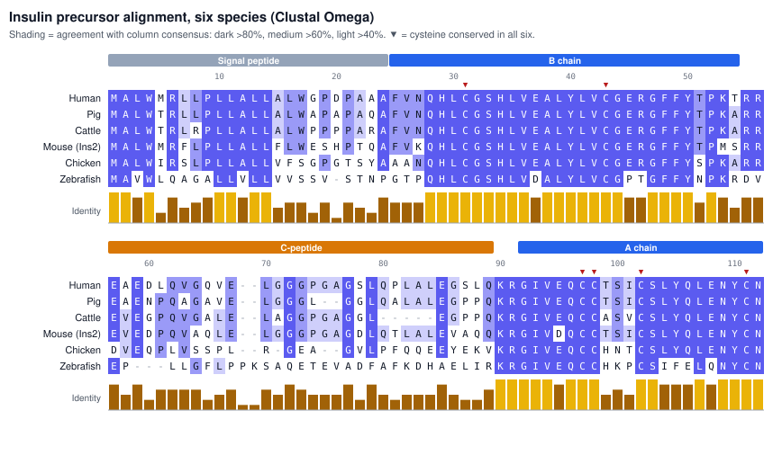
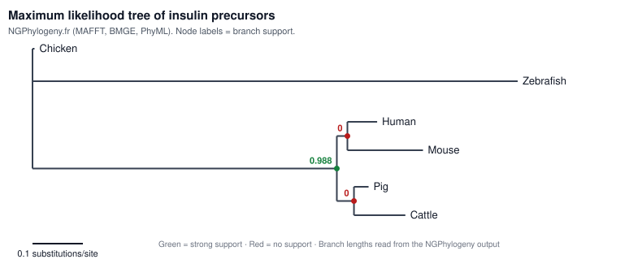

# Comparative Sequence Analysis of Insulin Across Six Species: Understanding Why Pig Insulin Was Preferred Over Cattle Insulin

## Table of Contents

1. [Research Question](#1-research-question)
2. [Data Collection](#2-data-collection)
3. [Methods](#3-methods)
4. [Results](#4-results)
   - [Finding 1: Sequence Length Comparison](#finding-1-sequence-length-comparison)
   - [Finding 2: Full Precursor Sequence Identity](#finding-2-full-precursor-sequence-identity)
   - [Finding 3: Active Hormone Comparison](#finding-3-active-hormone-comparison)
   - [Finding 4: Conserved Amino Acids](#finding-4-conserved-amino-acids)
   - [Finding 5: Cysteine and Hydrophobicity Analysis](#finding-5-cysteine-and-hydrophobicity-analysis)
5. [Conclusion](#5-conclusion)
6. [Limitations](#6-limitations)
7. [References](#7-references)

## 1. Research Question

How similar is insulin across six different species, and what do these sequence similarities reveal about the evolutionary conservation of insulin? This project also investigates why pig insulin was preferred over cattle insulin for treating human diabetes, based on differences in their amino acid sequences.

## 2. Data Collection

Six insulin protein sequences were retrieved from UniProt and analysed.

| Species | Protein / Gene | UniProt Accession | Sequence Length (aa) |
|---|---|---|---|
| Human | INS | [P01308](https://www.uniprot.org/uniprotkb/P01308) | 110 |
| Pig | INS | [P01315](https://www.uniprot.org/uniprotkb/P01315) | 108 |
| Cattle | INS | [P01317](https://www.uniprot.org/uniprotkb/P01317) | 105 |
| Mouse | Ins2 | [P01326](https://www.uniprot.org/uniprotkb/P01326) | 110 |
| Chicken | INS | [P67970](https://www.uniprot.org/uniprotkb/P67970) | 107 |
| Zebrafish | INS | [O73727](https://www.uniprot.org/uniprotkb/O73727) | 108 |

**Why Mouse Ins2?**
Mice have two insulin genes. Ins2 is the direct counterpart (ortholog) of human INS, while Ins1 is an extra copy found only in rodents, so Ins2 was used for comparison.

## 3. Methods

The following bioinformatics tools were used:

1. **UniProt:** Retrieved insulin protein sequences and their accession numbers from six species.
2. **EMBOSS Needle:** Performed global sequence alignment of the full human insulin precursor against each of the other five species to calculate sequence identity and similarity.
3. **EMBOSS Water:** Performed local sequence alignment of the human A and B chains against pig and cattle insulin to examine similarities and differences in the active hormone.
4. **Clustal Omega:** Performed multiple sequence alignment of all six insulin sequences to identify conserved and variable amino acid positions.
5. **Jalview:** Visualised the multiple sequence alignment and examined conserved amino acid residues.
6. **NGPhylogeny.fr:** Constructed a phylogenetic tree to study the evolutionary relationships among the six species based on their insulin sequences.
7. **Python (Biopython):** Analysed protein sequences by calculating sequence length, cysteine count and hydrophobic amino acid percentage.

## 4. Results

**Finding 1: Sequence length comparison**

The insulin precursor lengths ranged from 105 (cattle) to 110 (human, mouse) amino acids across the six species.

**Finding 2: Full precursor sequence identity**

EMBOSS Needle alignment showed that human insulin was 85.5% identical to pig insulin and 80.0% identical to cattle insulin.

**Finding 3: Active hormone comparison**

In the active hormone (A + B chains, 51 amino acids), human insulin showed:

- 98.0% identity with pig insulin, with 1 amino acid difference at B30.
- 94.1% identity with cattle insulin, with 3 amino acid differences at B30, A8 and A10.

**Finding 4: Conserved amino acids**

The B chain and A chain were highly conserved across all six species, while the signal peptide and C-peptide were variable and contained most of the gaps (Figure 1). All 6 cysteines aligned in the same columns in every species.

*Figure 1. Multiple sequence alignment of insulin precursors from six species (Clustal Omega), shaded by agreement with the column consensus. Coloured bars mark the signal peptide, B chain (columns 25–54), C-peptide (columns 57–89) and A chain (columns 92–112), based on human UniProt P01308. The B and A chains are highly conserved, while the C-peptide is variable and contains most gaps. Red triangles mark the six cysteines, conserved in every species.*

**Finding 5: Cysteine and hydrophobicity analysis**

Python analysis (Biopython) showed that all six species contained exactly 6 cysteine residues in the full insulin precursor. These correspond to the six cysteines that form insulin's three disulfide bonds, indicating that this structural feature is fully conserved from fish to mammals. Hydrophobic amino acid content (A, V, L, I, M, F, W) was similar across species, ranging from 36.4% (chicken) to 42.6% (pig).

| Species | Length (aa) | Cysteines | Hydrophobic (%) |
|---|---|---|---|
| Human | 110 | 6 | 40.9 |
| Pig | 108 | 6 | 42.6 |
| Cattle | 105 | 6 | 39.0 |
| Mouse (Ins2) | 110 | 6 | 40.9 |
| Chicken | 107 | 6 | 36.4 |
| Zebrafish | 108 | 6 | 39.8 |

**Finding 6: Phylogenetic analysis**

A maximum likelihood tree built with NGPhylogeny.fr (MAFFT alignment, BMGE trimming, PhyML) grouped the four mammals (human, pig, cattle, and mouse) together with strong support (0.988), separate from chicken and zebrafish (Figure 2). Zebrafish had the longest branch, consistent with fish being the most distantly related species. Within the mammals, the tree paired human with mouse and pig with cattle, but both groupings had a support value of 0, so insulin alone could not resolve relationships among the mammals.

*Figure 2. Maximum likelihood tree of insulin precursors from six species (NGPhylogeny.fr: MAFFT, BMGE, PhyML). Numbers at nodes are branch support values (green = strong, red = none). Scale bar: substitutions per site.*

## 5. Conclusion

Insulin's active A and B chains and all six cysteines are highly conserved across the six species, which explains why animal insulin can function in humans. Pig insulin differs from human insulin at only one position in the active hormone (B30), compared with three in cattle insulin (B30, A8, A10). Because pig insulin is closer to human insulin, it is less likely to be recognised as foreign by the immune system, which helps explain why it was preferred over cattle insulin for treating diabetes.

## 6. Limitations

1. Only six species were included in the analysis, so the findings may not represent insulin diversity across all organisms.
2. The phylogenetic tree strongly supported the mammal group (0.988) but could not resolve relationships within mammals (support 0), likely because insulin is a short protein with few informative positions.
3. Differences in immune response were inferred from sequence differences, not measured experimentally.

## 7. References

**Sequence database**

- UniProt: <https://www.uniprot.org/>

**Alignment and visualisation tools**

- EMBOSS Needle: <https://www.ebi.ac.uk/jdispatcher/psa/emboss_needle>
- EMBOSS Water: <https://www.ebi.ac.uk/jdispatcher/psa/emboss_water>
- Clustal Omega: <https://www.ebi.ac.uk/jdispatcher/msa/clustalo>
- Jalview: <https://www.jalview.org/>

**Phylogenetic analysis**

- NGPhylogeny.fr: <https://ngphylogeny.fr/>

**Programming**

- Biopython: <https://biopython.org/>
